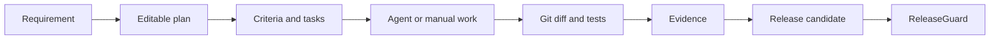

# DevCycle


## v2 development and licensing

Stable: v1.x (historical Apache-2.0 releases). Under development: v2 AI Engineering Team; not GA.

Community Edition: **AGPL-3.0-only** for this development source. Historical release rights remain valid.
Commercial / OEM licensing available for closed-source redistribution, white-labeling, embedding and other use cases incompatible with AGPL. See [license policy](LICENSE_POLICY.md), [history](LICENSING_HISTORY.md) and [commercial policy](COMMERCIAL_LICENSE.md).


DevCycle 是本地优先的 AI 开发生命周期工作台，把一句交付目标转成可编辑计划，再沿着验收标准、开发任务、Agent 会话、验证证据和发布候选形成一条可审计链路。

[](https://github.com/GeneJie199/ai-dev-cycle-manager/actions/workflows/ci.yml)
[](LICENSE)

## Screenshot


## Why

AI coding tools can produce code quickly, but they do not preserve why a change exists, what must pass, which evidence is current, or whether the result is ready to release. DevCycle keeps that lifecycle explicit without replacing the coding agent or Git.

## Core Features

- 从自然语言创建需求，手工或借助 AI 生成完整交付计划。
- 在保存和拆分前编辑范围、假设、待确认问题、验收标准、测试、任务依赖、风险、回滚与候选说明。
- 接入 Kimi、Codex、Claude 本机规划 CLI，以及 OpenAI Compatible、Anthropic、Gemini、本地 OpenAI/Ollama 和自定义 OpenAI API。
- 使用 Codex、Claude Code、Gemini CLI、Kimi Code、OpenCode 或安全的自定义命令适配器执行任务。
- 为任务创建独立 Branch + Worktree，保存 Agent 日志、生命周期、任务依赖与跨 Agent 交接记录。
- 运行 build/test/lint/smoke 命令，保存退出码、受限输出和标准化 Evidence。
- 以最新证据重新计算验收和发布就绪度，不能只靠前端勾选通过。
- 用 Humanized Git 展示新增、修改、删除、重命名、影响面、风险原因、建议验证和完整原始 Diff。
- 导出开发报告与发布候选 JSON，交给 ReleaseGuard 做独立发布验证。

Web UI、Lucide 图标和 SQLite 驱动全部嵌入单个 Go 二进制，运行时不依赖 Node、CDN、Prometheus 或云端控制面。

## Quick Start

需要 Go 1.26.6+ 和 Git。Agent 与 AI 是可选增强项，没有安装任何 AI 工具时，手工计划、Git、验证、证据和报告仍可完整使用。

```bash
go test ./...
go build -trimpath -o devcycle ./cmd/devcycle
./devcycle serve --db ./devcycle.db --addr 127.0.0.1:8766
```

Windows 使用 `devcycle.exe`。打开 `http://127.0.0.1:8766/` 后：

1. 在左侧输入想交付的目标并创建需求。
2. 让可用模型生成计划，或直接手工建立；逐项审阅后保存并拆为验收标准和任务。
3. 在“任务执行”导入仓库、创建隔离工作区，启动 Agent 或手工推进任务；需要换 Agent 时创建持久交接。
4. 在“验证证据”运行命令并登记代码、提交、测试、截图、HTTP 响应、制品或人工确认。
5. 在“报告发布”复核证据覆盖、代码来源和阻塞项，生成开发报告与发布候选。

也可以运行不依赖已有仓库的 CLI 演示：

```bash
./devcycle demo
```

## Online Install

The lowest-friction path installs the complete Open Suite, starts every local service, and includes DevCycle:

```bash
curl -fsSL https://raw.githubusercontent.com/GeneJie199/ai-devops-open-suite/main/scripts/bootstrap.sh | bash
```

```powershell
irm https://raw.githubusercontent.com/GeneJie199/ai-devops-open-suite/main/scripts/bootstrap.ps1 | iex
```

For DevCycle alone, download the archive for your platform from [Releases](https://github.com/GeneJie199/ai-dev-cycle-manager/releases/latest), extract it, and run the included `scripts/install.sh` or `scripts/install.ps1`. The installer can verify the release `checksums.txt` before copying the binary.

## Offline Install

On an online machine, download the matching `devcycle-<version>-<os>-<arch>` archive and release-level `checksums.txt`, and verify the archive before transfer. Extract once; the archive's own `checksums.txt` covers the platform-local `devcycle` binary used below:

```bash
sh scripts/install.sh install ./devcycle ./checksums.txt
```

```powershell
.\scripts\install.ps1 -Action Install -Source .\devcycle.exe -Checksums .\checksums.txt
```

The [full offline Open Suite bundle](https://github.com/GeneJie199/ai-devops-open-suite/releases/latest) includes DevCycle and all required protocol assets without accessing GitHub, npm, or a CDN during installation.

## First Five Minutes

1. Open `http://127.0.0.1:8766/`.
2. Add a local Git repository in **Settings**.
3. Enter one delivery goal on the workbench.
4. Review an AI-generated plan or create criteria and tasks manually.
5. Run validation, attach evidence, and export the release candidate.

## AI Optional

Without an AI provider, requirement editing, criteria, tasks, Worktrees, Git diff, validation, evidence, reports, and release candidates remain available. AI only drafts editable plans and explanations. It cannot mark evidence as passed, merge code, or approve a release.

## Comparison

| Tool category | What it does well | DevCycle's role |
|---|---|---|
| Coding agents | Implement code | Coordinates intent, task ownership, evidence, and handoff across agents |
| Issue trackers | Team backlog and collaboration | Keeps a local delivery chain tied to Git and executable verification |
| CI systems | Run remote pipelines | Runs bounded local checks and records evidence before a release candidate exists |
| Git clients | Branches and diffs | Explains user impact and ties changes back to acceptance criteria |

## Architecture



The embedded web app calls a loopback-only Go service backed by SQLite. Agent adapters are process boundaries; cross-product artifacts use versioned `lifecycle-spec` JSON rather than private database access.

## Security

- The service refuses non-loopback listeners.
- Secrets use the operating-system credential store or named environment variables and are redacted from logs, previews, and evidence.
- Agent and verification output is bounded; Git option-like revisions and unknown JSON fields are rejected.
- Releases include SHA-256 checksums, a CycloneDX SBOM, and GitHub build provenance.

See [SECURITY.md](SECURITY.md) and [docs/operations.md](docs/operations.md).

## Roadmap

The v1.0 boundary is a stable local single-user workbench. Multi-user collaboration and hosted control planes remain post-1.0 work tracked in the [Open Suite roadmap](https://github.com/GeneJie199/ai-devops-open-suite/blob/main/ROADMAP.md).

## Contributing

Start with [CONTRIBUTING.md](CONTRIBUTING.md). Use the issue templates for reproducible bugs and feature proposals; report vulnerabilities privately through [SECURITY.md](SECURITY.md).

## Product Reference

## 产品界面

| 页面 | 交付能力 |
|---|---|
| 工作台 · 意图与计划 | 自然语言需求、AI 发送前预览、完整可编辑计划与原子拆分 |
| 工作台 · 验收标准 | 标准编辑、证据关联、通过与撤回 |
| 工作台 · 任务执行 | 依赖阻塞、Worktree、Agent 会话、日志与任务交接 |
| 工作台 · 验证证据 | 后台验证、实时输出、停止/超时/恢复、八类证据 |
| 工作台 · 报告发布 | 就绪度、来源提交、开发报告和发布候选 |
| 活动 | 全局 Agent 会话与验证运行状态 |
| 代码 | 结构化 Diff、原始 Diff、影响分析和 AI 改动解释 |
| 设置 | AI 提供方、Agent 适配器与本地仓库 |

桌面与移动端使用同一套界面。移动端以“需求列表 → 单需求详情”导航，五个阶段在容器内横向滚动，不会造成页面级溢出。

## AI 与 Agent 细节

AI 规划和代码解释始终先给出可审阅结果，不会自动写代码、合并分支或批准发布。API 提供方发送前会显示目标地址、模型、脱敏内容和明确的数据边界。

API Key 默认保存到操作系统凭据库，或在运行时从指定环境变量读取。Linux 无系统 Secret Service 时，可在 Web 中显式选择当前用户专属的私有文件后端（目录 0700、文件 0600；拒绝 symlink、非 owner 和宽权限）。私有文件不是 OS 加密；Windows 继续使用 Credential Manager。SQLite、日志和 HTTP 响应中不保存凭据值。带凭据的远端提供方强制 HTTPS，本机回环地址可以使用 HTTP，请求禁止跨地址重定向并限制响应大小。

Agent 命令以可执行文件和参数数组直接启动，不经过 Shell。自定义适配器必须且只能包含一个 `{{prompt}}` 参数占位符，不能注入环境变量或 Shell 片段。详细配置见 [docs/configuration.md](docs/configuration.md)。

## HTTP API

| 路径 | 能力 |
|---|---|
| `/api/requirements` | 需求 CRUD、详情、报告与发布候选 |
| `/api/requirements/{id}/plan` | 读取和保存带修订号的完整计划文档 |
| `/api/requirements/{id}/ai-plan` | 生成计划草稿 |
| `/api/requirements/{id}/ai-plan/apply` | 原子拆分计划为标准和任务 |
| `/api/requirements/{id}/criteria`、`/api/criteria/{id}` | 验收标准创建、编辑、证据通过、撤回与删除 |
| `/api/tasks`、`/api/tasks/{id}` | 任务、依赖与状态 |
| `/api/tasks/{id}/worktree` | 创建并关联 Branch + Worktree |
| `/api/tasks/{id}/handoffs`、`/api/handoffs/{id}/accept` | 创建与接收任务交接 |
| `/api/agent-adapters` | 内置与自定义 Agent 适配器 |
| `/api/agent-sessions` | 启动、查询、停止会话并读取日志 |
| `/api/ai/providers` | API/CLI 提供方、凭据状态与连接测试 |
| `/api/ai/request-preview` | AI 出站请求预览与脱敏结果 |
| `/api/requirements/{id}/runs` | 后台验证运行与停止 |
| `/api/requirements/{id}/evidence` | 八类 Evidence 的创建和查询 |
| `/api/git/*` | status、structured diff、raw diff、branches、log、impact、AI explain |

所有写入 body 使用 JSON；未知字段被拒绝，请求体上限为 1 MiB。规划协议见 [docs/planning-document.md](docs/planning-document.md)。

## CLI

```text
devcycle version
devcycle import|status|branches|log|diff --repo PATH
devcycle worktree list|add|remove ...
devcycle requirement create|list|export|report ...
devcycle evidence add|list ...
devcycle verify --req ID --name NAME --command COMMAND --cwd PATH
devcycle task create|link|list ...
devcycle serve [--db PATH] [--addr 127.0.0.1:8766]
```

默认数据库是 `./devcycle.db`，可用 `--db` 或 `DEVCYCLE_DB` 覆盖。

## 安全与运维细节

服务硬性拒绝非 loopback 地址，因为本地 API 可以启动用户确认过的命令和 Agent。远程工作站请保持 DevCycle 监听本机，再通过 SSH 隧道访问。

Linux/macOS 用户可运行：

```bash
sh ./scripts/install.sh ./devcycle
```

备份、恢复、异常退出恢复和 systemd 用户服务见 [docs/operations.md](docs/operations.md)。发布标签自动构建 Linux、macOS、Windows 二进制并生成 SHA-256 校验文件。

## Known Limitations

- DevCycle 不替代代码编辑器或 coding agent，也不伪造 Agent 完成状态。
- 不自动合并 Git 分支，不自动批准验收，不直接上线。
- 当前是单用户、本机工作台，没有多人账户、RBAC 或云同步。
- 验证命令和 Agent 提示来自本地可信用户，应像脚本一样审核。

发布候选使用 `lifecycle-spec/release-candidate/v1`，ReleaseGuard 会重新校验 readiness 和证据覆盖。AGPL-3.0-only；贡献流程见 [CONTRIBUTING.md](CONTRIBUTING.md)，安全问题见 [SECURITY.md](SECURITY.md)。

## AI Team development preview

Open `/team.html` in a locally built DevCycle. Simple and Expert share the durable team runtime, capability/model routing, memory, risk and evidence. First configure an explicit model-aware adapter. Read [runtime](docs/AI_TEAM_RUNTIME.md), [routing](docs/MODEL_ROUTING.md), [memory](docs/PROJECT_MEMORY.md), and [risk](docs/RISK_MODEL.md). This is a development preview, not v2 GA.


## C2 / RC.2：首次使用、Provider 与 Delivery

打开 `/suite.html` 使用统一工作入口，或 `/team.html` 进入 AI Team 引导。先连接并测试正式 Provider，选择或从 Web 创建空 Git 项目，再选择验收检查与执行范围；常规初始化无需编写 Capability Registry JSON。尚未配置模型时仍可查看安装状态、项目、已有记录和各产品本地工具。外部模块“有入口”不代表“健康”，空数据不使用示例指标填充。

Provider 中心复用已有 HTTP Service、OS keyring / env SecretStore、Agent Adapter、Team 路由和 sidecar。API 型号通过用户显式触发的 `/models` 发现后选择，或填入已验证的正式型号；不会写死猜测型号。Codex 引导适配器使用用户正式授权的 CLI 与所选型号。Kimi 未授权时显示 Configuration Required / BLOCKED；聊天订阅不等于 Coding API 权限。

所有 HTTP 生成、连接测试和模型发现都须有明确请求预算。金额以整数百万分之一 CNY 保存，预先按完整请求输入上界与 `max_tokens` 预留费用，次数和金额任一达到上限即阻断。模型发现计入请求次数但无生成 token 费用；正常生成按实际有效 usage 和配置单价结算。缺失、负值、超界或不一致 usage 会保留整笔预留并阻断后续；显式接受完整预留费用后，仍须重新测试连接且只能使用剩余预算。费用是按配置最高适用单价估计，不是服务商账单。预算保存、连接撤销及同 ID 重建均不清零计数；同一数据库的第二个 Team 执行进程被现有独占锁拒绝。请为独立安装使用独立数据目录，不将本地可信单用户边界宣称为多租户隔离。

API Coding 使用严格单对象 JSON 的受控文本编辑协议：最多 100 个已跟踪非敏感文件、上下文编码字节上限、路径 / symlink / `.git` / secret 检查、角色路径权限和整批预先校验。它不提供 shell、搜索、抓取或部署工具；现有 Controller 在本地运行用户选择的真实机器检查。会话、worktree、审计、完整响应哈希、严格 Review、修复循环和 source-bound evidence 均沿用原 Runtime。需要复杂本地工具时使用正式 CLI，而不是假装 API 已拥有未实现工具。

Delivery 页面展示实际修改、已完成 / 未完成任务、真实检查、所有 Review 尝试、风险、真实 Diff 与可下载证据包。没有经过验证的应用预览或启动指令时明确显示不可用，不猜测部署命令；Candidate ready 和 Guard GO 都不等于生产发布授权。共享浅色 / 深色 / 跟随系统主题与移动导航覆盖 Suite、Team、Provider、Delivery 及原工作台子页面。

诊断接口 `GET /api/team/diagnostics/runtime` 仅返回真实数值：goroutines、heapAllocBytes、heapSysBytes、heapInuseBytes、systemBytes、gcCount、uptimeSeconds，并保留 Host / Origin 限制；没有 pprof、堆栈、环境或配置。

本版本仍为 RC。真实 Kimi、三模型协作、24 小时观察和 GA 资格须由独立机器证据确认；界面或本地 fixture 通过不能替代真实 Provider 验收。
